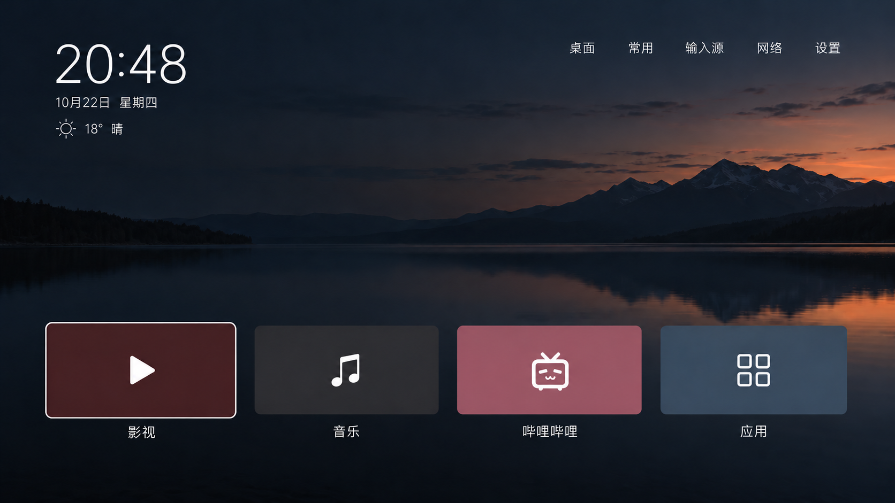

# cleanyourtv-c

参考 [Gathin23/cleanyourtv](https://github.com/Gathin23/cleanyourtv) 实现的 Android TV / Google TV 原生 Java 桌面，支持 Android 8.0（API 26）及以上系统。

仓库：[ecojust/cleanyourtv-c](https://github.com/ecojust/cleanyourtv-c)



## 功能

- 极简深色桌面：左上时间与日期、右上文字导航、底部四个纯色卡片，细白框提示焦点。
- 四个入口：影视、音乐、哔哩哔哩、应用。影视通过电视浏览器打开 [Plex 免费点播区](https://watch.plex.tv/on-demand)，采用深色海报式页面，以海外影视为主，具体片源和播放受地区限制；音乐通过电视浏览器打开 [SomaFM 免费网络电台](https://somafm.com/player/)，无需账号即可收听，未安装或未启用浏览器时显示提示；哔哩哔哩优先打开已安装的 TV 版，没有安装时明确提示。
- 点击「应用」或在桌面按下方向键，进入独立应用列表页，当前提供 8 个占位应用；点击显示「暂未配置」，返回键回桌面。
- 菜单键打开快捷设置；顶栏「常用」将焦点移回底部快捷入口。
- 桌面设置：减弱动画、本地壁纸、每日随机壁纸。桌面固定四列，应用页随屏幕宽度采用三列或四列。
- 时钟、日期、可选时钟屏保；可选天气、城市搜索和空气质量。
- 简体中文、繁体中文及参考项目提供的其他语言，跟随系统语言。
- 可选无障碍服务：Home 键回顶、在其他应用中打开快捷设置。

独立包名为 `com.ecojust.cleanyourtv`，可以与参考项目同时安装。设置和壁纸各自保存。

## 下载

[下载 v0.1.0 APK](https://github.com/ecojust/cleanyourtv-c/releases/tag/v0.1.0) · [全部版本](https://github.com/ecojust/cleanyourtv-c/releases)

## 构建

需要 JDK 17 或 21、Android SDK Platform 35 与 Build Tools 34.0.0。设置 `ANDROID_HOME`，或在 `launcher/local.properties` 中写入 `sdk.dir=/你的/SDK/路径`。

```bash
cd launcher
./gradlew assembleDebug
# Windows: .\gradlew.bat assembleDebug
```

安装包：`launcher/app/build/outputs/apk/debug/app-debug.apk`。首次构建需要联网下载 Gradle 和依赖。使用 Android 默认本地 debug 签名，不依赖原作者电脑上的密钥。

```bash
./gradlew assembleRelease lintDebug testDebugUnitTest
```

Release 启用 R8 和资源压缩。未提供签名配置时输出 `app/build/outputs/apk/release/app-release-unsigned.apk`；设置 `ANDROID_KEYSTORE_PATH` 与 `ANDROID_KEYSTORE_PASSWORD` 后输出已签名的 `app-release.apk`，密钥别名为 `cleanyourtv-c`。后续升级必须继续使用同一密钥，不要把密钥提交到仓库。正式发布页提供已签名的 APK。

GitHub Actions 会构建 Debug、Release 并运行 lint、壁纸下载测试及页面导航测试；仓库签名 Secrets 可用时自动签名 Release，否则输出未签名构建，APK 可在对应工作流的 Artifacts 下载。CI Debug 密钥不保证跨运行一致；需要持续覆盖升级时请在本地使用固定密钥构建。

## 安装与使用

电视启用开发者选项和 USB/网络调试，并允许电脑连接。电视与电脑在同一网络：

```bash
adb connect <电视IP>:5555
adb -s <电视IP>:5555 install -r launcher/app/build/outputs/apk/debug/app-debug.apk
adb -s <电视IP>:5555 shell cmd package set-home-activity --user 0 com.ecojust.cleanyourtv/.MainActivity
adb -s <电视IP>:5555 shell am start -n com.ecojust.cleanyourtv/.MainActivity
```

也可以把 APK 拷到电视，用文件管理器安装，再从系统设置选择默认桌面。部分厂商固件限制第三方桌面，是否可用取决于设备。

一键构建安装（需要 `adb` 在 PATH 中）：

```bash
TV_HOST=192.168.1.50 ./launcher/build-and-install.sh
```

Windows PowerShell：

```powershell
$env:TV_HOST = "192.168.1.50"
.\launcher\build-and-install.ps1
```

脚本不会禁用原厂桌面。要还原，请在系统设置中选择原桌面，或执行：

```bash
adb shell cmd package set-home-activity --user 0 <原桌面包名/Activity>
```

建议替换前先通过 `adb shell cmd package resolve-activity --brief -a android.intent.action.MAIN -c android.intent.category.HOME` 记录原桌面组件。

## 个性化

在顶栏「桌面」中设置壁纸、动画和天气。当前应用列表为占位预览，尚未接入已安装应用枚举；后续可替换为真实应用。应用页按返回键或点击「返回」回到桌面，桌面保留离开时的焦点。

天气与每日随机壁纸默认关闭，启用后需要联网。在线壁纸使用 `https://picsum.photos/1920/1080?random=1`，按需跟随 HTTPS 重定向获取 1920×1080 图片，每天最多成功更新一次；下载失败保留原壁纸。天气请求使用 Open-Meteo；手动点击城市定位时会请求 ipinfo.io。Wi-Fi 名称读取在部分 Android 版本需要位置权限，天气本身不依赖 GPS。

可选 Home 键增强：在系统「无障碍 → 已下载的服务」启用本应用的「Home 键回顶」。屏保可在系统屏保设置中选择。

进阶配置目录：`/sdcard/Android/data/com.ecojust.cleanyourtv/files/`。支持 `config.json` 和固定文件名 `wallpaper.jpg`（内容可为 JPEG、PNG 或 WebP），修改后重启桌面。背景色、输入源等默认配置见 [config.xml](launcher/app/src/main/res/values/config.xml)。旧的 Dock 和列数配置不作用于当前固定四入口桌面。

```bash
./tools/set-wallpaper.sh <电视IP> <图片路径>
```

[桌面渲染预览](docs/previews/home-render.png) · [应用页渲染预览](docs/previews/apps-render.png)（Robolectric 渲染，非电视实机截图）。完整验证记录与限制见 [VALIDATION.md](docs/VALIDATION.md)。

## 来源与许可

本项目参考自 [Gathin23/cleanyourtv](https://github.com/Gathin23/cleanyourtv)，本分支实现极简桌面与独立应用列表页，并适配独立应用标识、构建签名、安装工具及自动构建。原作者 Gathin、mclhm8182 的版权保留在 [LICENSE](LICENSE) 和 [NOTICE.md](NOTICE.md)。Outfit 字体使用 [SIL OFL](launcher/FONT-LICENSE-OFL.txt)。
