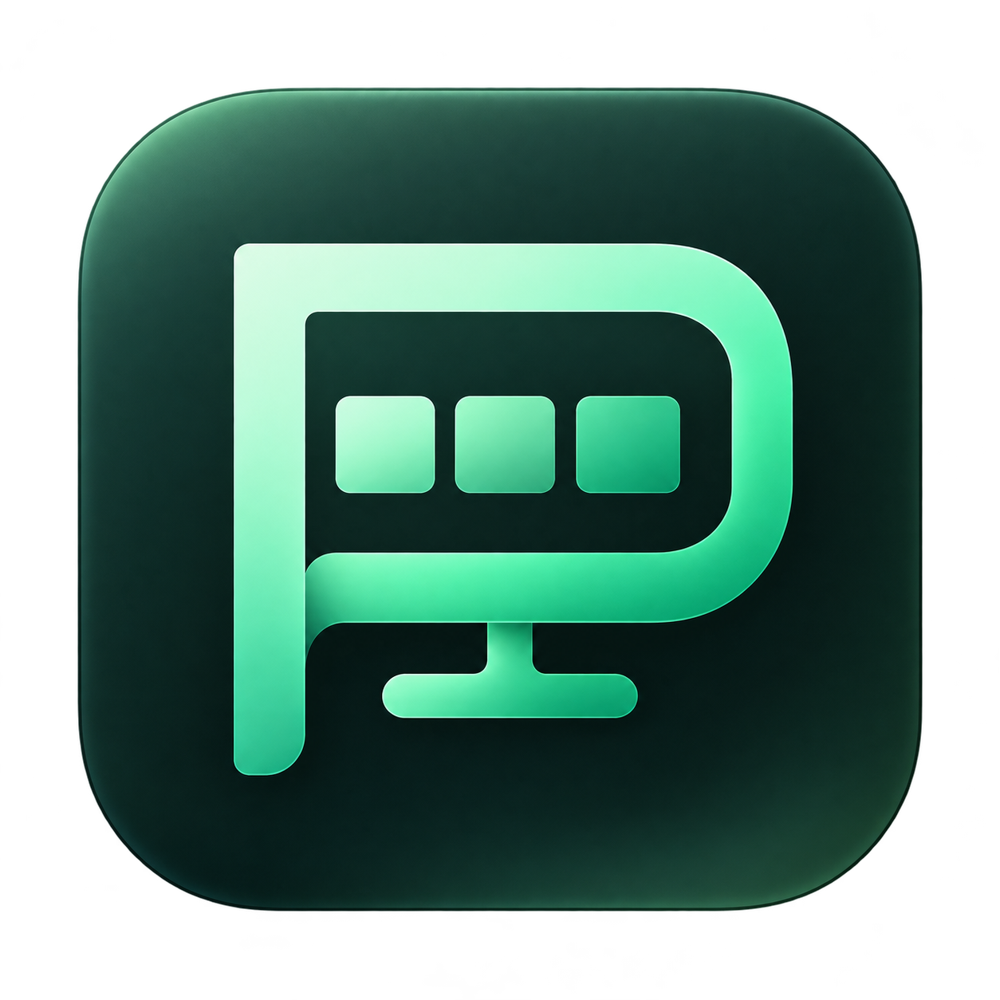
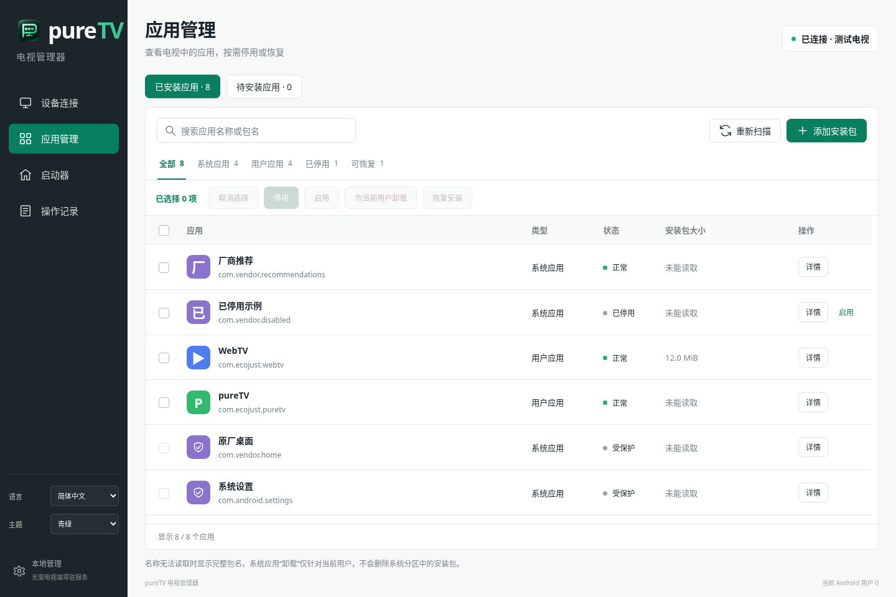
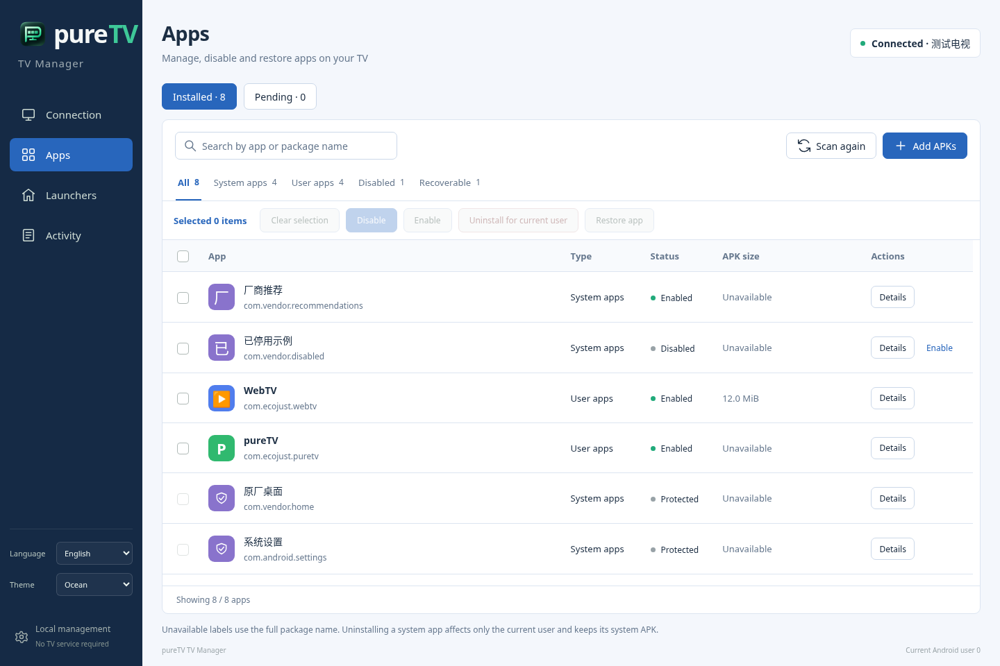
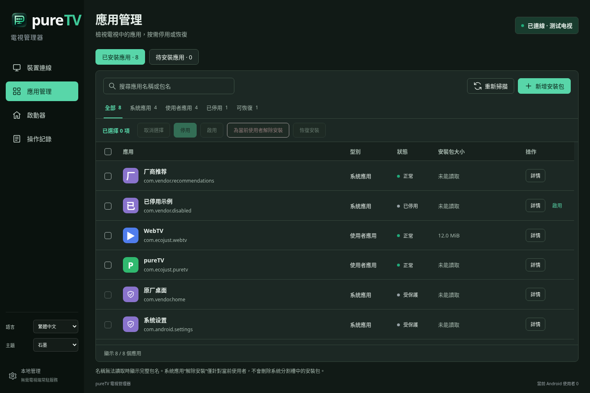
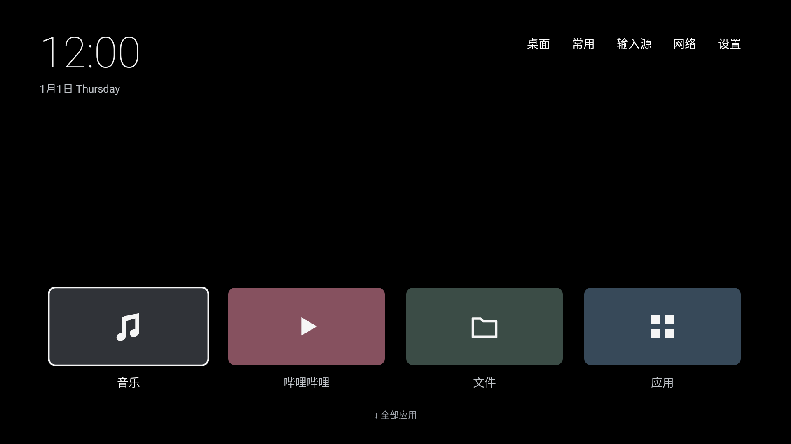
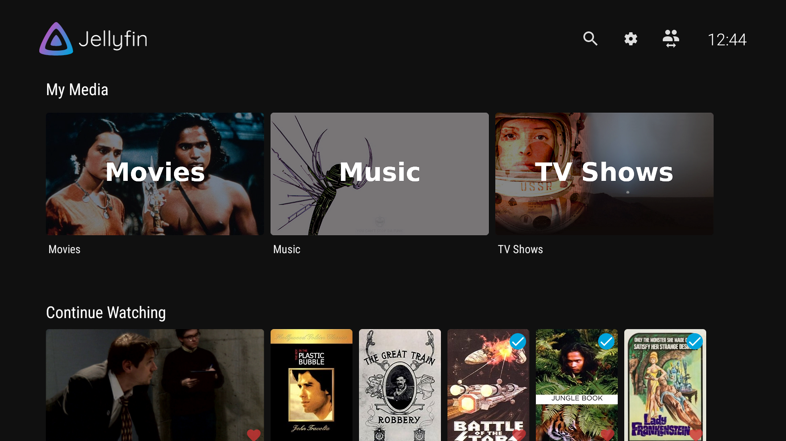
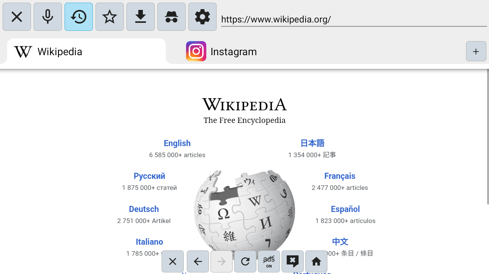
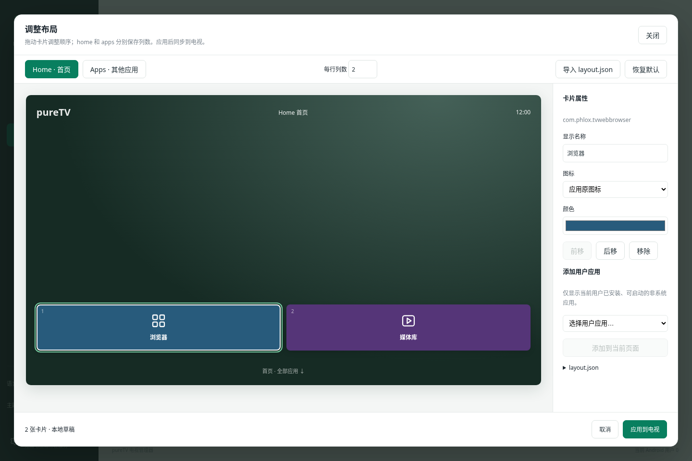
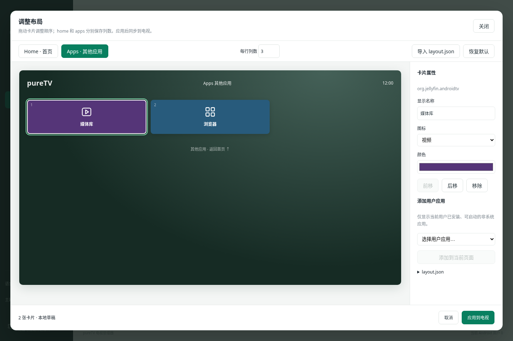

<div align="center">
  
  <h1>pureTV</h1>
  <p>管理你的电视系统、应用与桌面。</p>
</div>

pureTV 是电脑端的 Android TV / Google TV 系统管理器。通过 ADB 连接电视，查看系统信息，安装、卸载、启停应用，选择启动器，并用可视化画布自定义支持的桌面。也可通过 MCP 让 Agent 控制已打开的管理器。



## 下载

[下载 pureTV Manager 0.3.0](https://github.com/ecojust/pureTV/releases/tag/desktop-v0.3.0)

| 系统 | 安装包 |
| --- | --- |
| Windows x64 | 安装版 EXE / 便携 EXE |
| macOS Apple Silicon | ARM64 DMG，macOS 11+ |
| macOS Apple Intel | x86_64 DMG，macOS 11+ |
| Linux x64 | DEB |

管理器安装在**电脑**上。电视开启 ADB／网络调试并接受授权后，即可使用应用管理，不需要安装电视端常驻服务。自定义桌面需另行安装[配套 pureTV Launcher 0.3.0](https://github.com/ecojust/pureTV/releases/tag/v0.3.0)。包大小与 SHA256 见发布附件；macOS 首次打开说明见[安装指南](desktop/README.md#macos-安装与首次打开)。

## 连接与应用管理

1. 电脑和电视接入可互通的网络，在电视开发者选项中开启 ADB／网络调试。
2. 首页输入电视 IP／主机名与调试端口，在电视上允许电脑连接。常见端口为 5555，以电视实际设置为准。
3. 缺少 ADB 时，阅读并同意 Android SDK 许可后点击「下载并配置 ADB」；优先 Google，失败时使用腾讯镜像。也可选择已有 ADB。

连接后首页显示型号、Android／SDK／安全补丁、CPU、内存、`/data` 磁盘容量、分辨率及运行时间。其他页面顶部保留当前连接状态。

- **应用管理**：搜索和分类，批量启用／停用、为当前用户卸载、恢复仍保有安装包的系统应用。
- **待安装应用**：导入本地 APK，可在行尾安装单个，也可勾选批量安装；成功项移出队列，失败与未执行项保留。
- **启动器**：导入启动器 APK 后在该页面直接安装，选择／恢复默认桌面；支持接口的当前启动器显示「调整布局」。
- 应用与启动器均显示主 APK 与分包的合计大小，不含私有数据、缓存与优化文件，无法读取时明确显示未知。
- 列表内部滚动，表头和顶部批量操作固定；核心系统组件与当前默认启动器受保护。

系统应用卸载只针对当前 Android 用户，保留数据，不删除系统分区 APK。新安装且具备启动入口的用户应用可加入启动器排布。

## 语言、主题与 Logo

左下角可切换 **简体中文 / 繁體中文 / English**，以及 **青绿 / 深蓝 / 石墨** 三种主题。偏好保存后重启仍生效；应用名称、包名及文件路径保持原样。新 Logo 将 P、电视屏幕与应用卡片融为一个图形。

| English · 深蓝 | 繁體中文 · 石墨 |
| --- | --- |
|  |  |

## 启动器与电视应用资源

公共目录为 [resource/](resource/)。每个软件文件夹至少包含一个实际 APK，可同时提供对应版本源码、封面、作者、许可证及 SHA256。点击软件名称进入对应文件夹。

启动器表格的“支持自定义”指支持本管理器的 **layout.json 版本 2 画布接口**。卡片背景仅在提供 `thumb.png`／`APK名.thumb.png` 等图片，或手动选择图片后显示。

<!-- resource-index:start -->

### 启动器

| 名称 | 作者 | 版本 | 支持自定义 | 封面截图 |
| --- | --- | --- | --- | --- |
| [pureTV Launcher](resource/puretv-launcher/) | ecojust / 桔子桑 | 0.3.0 | 是 |  |

### 电视应用

| 名称 | 作者 | 版本 | 用途 | 封面截图 |
| --- | --- | --- | --- | --- |
| [Jellyfin for Android TV](resource/jellyfin-tv/) | Jellyfin contributors | 0.19.10 | Jellyfin 媒体服务器的 Android TV 客户端 |  |
| [TV Bro](resource/tvbro/) | Fedir Tsapana (truefedex) | 2.1.6 | 适配遥控器的电视浏览器，使用系统 WebView |  |

<!-- resource-index:end -->

其他电视应用的源码工程见 [apps/](apps/)。第三方资源保留各自作者、原始签名和许可证，不纳入 pureTV 的 MIT 授权范围。

## layout.json 规范与画面对照

在当前默认且支持接口的启动器卡片上点击「调整布局」，打开全局电视画布。Home 与 Apps 分别设置列数，拖动卡片或用前移／后移按钮排序，再修改名称、图标和颜色。「应用到电视」确认后才保存，并读回核验；「取消」放弃草稿。

**只能添加当前用户已安装、启用且可启动的非系统应用。** 下例使用资源目录中的 TV Bro 和 Jellyfin TV，需要先安装这两个应用。示例文件：[layout.example.json](resource/puretv-launcher/layout.example.json)。

```json
{
  "version": 2,
  "home": {
    "columns": 2,
    "items": [
      {"packageName": "com.phlox.tvwebbrowser", "label": "浏览器", "icon": "app", "color": "#285B7C"},
      {"packageName": "org.jellyfin.androidtv", "label": "媒体库", "icon": "video", "color": "#553578"}
    ]
  },
  "apps": {
    "columns": 3,
    "items": [
      {"packageName": "org.jellyfin.androidtv", "label": "媒体库", "icon": "video", "color": "#553578"},
      {"packageName": "com.phlox.tvwebbrowser", "label": "浏览器", "icon": "app", "color": "#285B7C"}
    ]
  }
}
```

| 文件字段 | 规范 |
| --- | --- |
| `version` | 必须为 `2` |
| `home` / `apps` | 各自包含 `columns` 和 `items` 的页面对象 |
| `columns` | 每行 1–6 列，两页独立设置 |
| `home.items` | 有序卡片数组，0–24 项 |
| `apps.items` | 其他应用页有序卡片数组，0–100 项 |
| `packageName` | 用户应用包名；同页不可重复，写入时核验已安装与可启动状态 |
| `label` | 可选，最长 100 字；省略时读取应用名称 |
| `icon` | 可选：`app`、`music`、`video`、`files`、`apps`、`picture`、`settings`、`input`；`app` 使用原应用图标 |
| `color` | 可选，`#RRGGBB` 格式 |
| `action` | 模板内置入口：`music`、`bilibili`、`files`、`apps`（应用商城）、`shortvideo`、`webtv`、`placeholder`；不与 `packageName` 同时指定 |

数组顺序按**从左到右、从上到下**排列；不足一行时留空，不生成额外卡片。默认模板还含启动器内置入口 `action`，不能同时指定 `packageName`。文件为 UTF-8，最大 48 KiB，不接受未知字段、任意命令、Intent 或远程脚本。

| JSON 页面 | 对应画布 |
| --- | --- |
| `home.columns = 2`；第 1 项为浏览器，第 2 项为媒体库 |  |
| `apps.columns = 3`；第 1 项为媒体库，第 2 项为浏览器，第 3 格留空 |  |

上面两张画布截图与 JSON 使用相同的配置和示例应用数据，不是实机录屏。电视端在页面恢复／配置应用时动态加载布局，无需重新编译。管理器写入的私有 `files/layout.json` 优先于外部 `Android/data/com.ecojust.puretv/files/layout.json`；**不读取、不迁移旧版 `apps.json`**。完整接口与模板说明见[布局文档](desktop/docs/launcher-layout.md)。

## MCP / Agent

在「设备连接 → MCP · Agent 调试」复制配置到客户端，保持管理器窗口打开。28 个工具覆盖系统信息、连接、应用管理、APK 安装、启动器切换与布局、背景图、ADB 配置、语言与主题、取消及记录；Agent 与界面共享状态。

[完整 MCP 接入与参数](desktop/docs/mcp.md)。

## 电视端包名与升级

当前包名为 **`com.ecojust.puretv`**，沿用 pureTV 0.2.0 的发布证书，可覆盖升级。更早的 `com.ecojust.cleanyourtv` 是另一个应用，需要独立安装并重新选择默认桌面，不能继承其私有设置。建议先保留原桌面，确认新版运行正常后再处理旧应用。

## 开发与验证

电脑端：[构建与运行](desktop/README.md)。电视端使用 JDK 17／21、Android SDK Platform 35、Build Tools 34.0.0：

```bash
cd launcher
./gradlew assembleDebug assembleRelease lintDebug testDebugUnitTest
```

资源校验：`python tools/resource_catalog.py --build-tools <Build Tools 34.0.0 路径>`。资源索引：`python tools/update-resource-index.py`。

项目使用核心、界面、四平台构建、原生管理器 MCP 联调与 Android 布局测试验证。尚未进行电视实机测试。

## 许可与致谢

pureTV 使用 [MIT](LICENSE) 许可。部分电视端启动器代码参考 [Gathin23/cleanyourtv](https://github.com/Gathin23/cleanyourtv)，原作者版权与许可保留于 [NOTICE.md](NOTICE.md)。字体见 [OFL 许可](launcher/FONT-LICENSE-OFL.txt)。第三方 APK、截图与源码使用各资源文件夹内的许可证。
