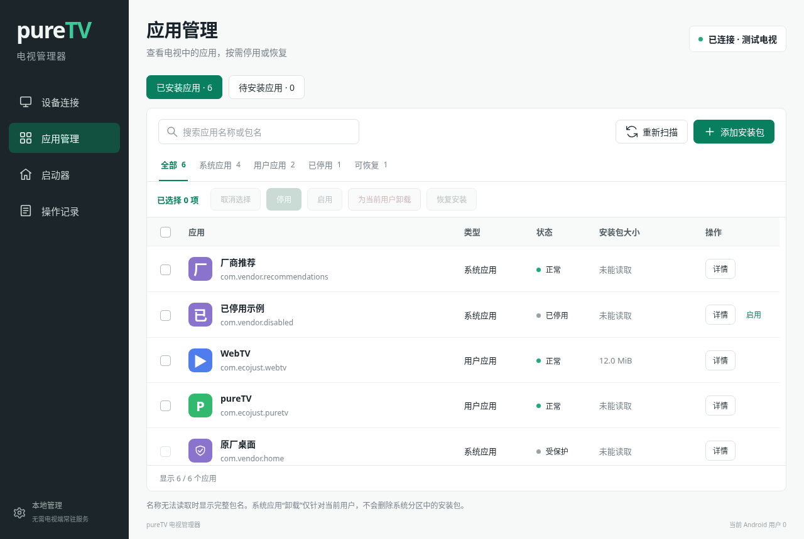
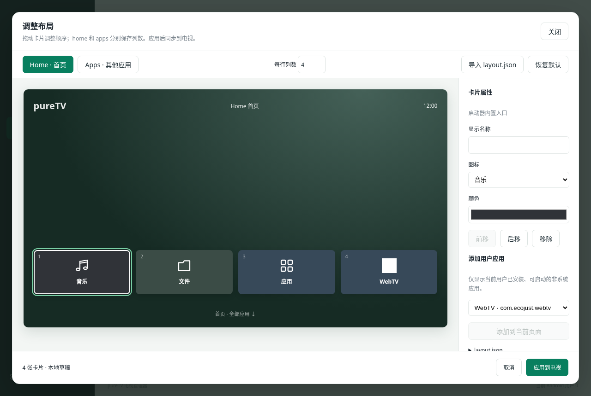

# pureTV

**专门管理电视系统的电脑端工具。** 通过 ADB 连接 Android TV / Google TV，查看设备信息、管理应用、安装自定义 APK、选择与自定义启动器。也可通过 MCP 让 Agent 操作当前管理器窗口。

仓库：[ecojust/pureTV](https://github.com/ecojust/pureTV)



## 下载与安装

[pureTV Manager 0.2.1 · 电脑端管理器](https://github.com/ecojust/pureTV/releases/tag/desktop-v0.2.1)

| 电脑系统 | 安装包 |
| --- | --- |
| Windows x64 | 安装版 EXE / 便携 EXE |
| macOS Apple Silicon | ARM64 DMG，macOS 11 及以上 |
| Linux x64 | DEB，需兼容的 GTK / WebKitGTK 运行环境 |

文件大小及 `SHA256SUMS.txt` 见发布页。Windows 使用 WebView2；便携版需要电脑已具备该运行时。macOS 首次打开说明见[安装指南](desktop/README.md#macos-安装与首次打开)。

管理器安装在**电脑**上。电视开启 ADB／网络调试并接受连接授权即可使用应用管理等功能，不需要额外安装管理服务。要使用 pureTV 的自定义桌面布局，再按需安装[电视端 pureTV 启动器 0.2.1](https://github.com/ecojust/pureTV/releases/tag/v0.2.1)。

## 连接与系统信息

1. 电脑和电视接入可互通的网络，在电视开发者选项中开启 ADB／网络调试。
2. 在管理器首页填写电视 IP／主机名与调试端口，连接后在电视上允许授权。
3. 缺少 ADB 时点击「下载并配置 ADB」，阅读并同意 Android SDK 许可后自动下载、校验和配置；优先 Google，失败时尝试腾讯镜像。也可手动选择已有 ADB。

连接后首页展示型号、Android／SDK／安全补丁、制造商、CPU／架构、内存、`/data` 磁盘容量、分辨率与运行时间，支持刷新。权限或固件限制导致读不到的数据明确显示未知。其他页面顶部只保留当前连接状态。

## 应用管理

- **已安装应用**：搜索、筛选、批量启用／停用、为当前用户卸载、恢复系统中仍保有安装包的应用。
- **待安装应用**：导入自己的本地 APK，逐项安装或勾选批量安装；成功项从待安装列表移除，失败或未执行项保留供核对和重试。
- 应用和启动器均显示**安装包大小**，包含主 APK 与分包 APK，不包含私有数据、缓存或优化文件。无法读取时显示「未能读取」，不编造零值。
- 应用、启动器、待安装 APK 和操作记录独立滚动，表头固定；批量选择及操作按钮位于列表顶部，勾选不会跳回开头。

卸载只针对当前 Android 用户，保留数据，不删除系统分区 APK。核心系统组件和当前默认启动器受保护。安装结果会刷新应用列表；具备启动入口的新应用可加入启动器排布。

## 启动器与自定义布局

在「启动器」查看已安装桌面、包大小，选择默认启动器，或恢复记录的原桌面。可直接导入本地启动器 APK 并逐项安装。卡片只在用户提供图片时显示背景图，支持同目录 `thumb.png`／`APK名.thumb.png`，也可手动选择背景图。

管理器会先读取**当前默认启动器的自定义能力**。支持已适配接口时，当前默认启动器显示「调整布局」。点击打开全局电视画布，拖动卡片调整顺序，分别编辑 home、apps 页面列数、名称、图标与颜色，通过 `layout.json` 应用并读回核对。可添加的应用仅限已安装、可启动的用户应用。旧版 `apps.json` 不再读取。图标来自电视实际安装的应用，也可选择内置图标。

当前适配 **pureTV 0.2.1 的布局接口**。其他启动器需适配其可靠接口后才能编辑；未适配时明确显示不可编辑，不猜测和改写未知配置。详见[启动器布局与 layout.json](desktop/docs/launcher-layout.md)。



### 新包名

电视端 pureTV 的新包名为 **`com.ecojust.puretv`**。旧版使用 `com.ecojust.cleanyourtv`；Android 将它们视为两个应用，需安装新 APK 后重新选择默认桌面，不能直接覆盖旧包。新包使用独立的 pureTV 发布证书，后续版本保持同一证书以支持升级。

推荐先保留原桌面，安装并切换到新版，确认布局和操作正常后再决定如何处理旧应用。

## MCP / Agent

管理器打开后，在「设备连接 → MCP · Agent 调试」复制配置到客户端。使用标准 stdio 接入，Agent 与窗口共享设备、用户、操作锁和记录，操作状态、错误、布局及画面同步显示。

工具覆盖系统信息、连接、应用管理、APK 安装、启动器切换与布局、ADB 配置、背景图、取消和记录。完整接入及参数见 [MCP 文档](desktop/docs/mcp.md)。

## 可选电视应用

电视上的启动器和播放器独立安装，不捆绑进电脑管理器，也不会因管理器升级增大已有电视 APK。

| 应用 | 用途 |
| --- | --- |
| pureTV Launcher | 可自定义 Android TV 桌面，支持 layout.json |
| [Music TV](apps/music/README.md) | 音乐与本地音频播放 |
| [ShortVideo TV](apps/shortvideo/README.md) | 短视频播放 |
| [WebTV](apps/webtv/README.md) | M3U 电视直播 |

## 开发与验证

电脑端构建、运行环境与测试：[desktop/README.md](desktop/README.md)。电视端需 JDK 17／21、Android SDK Platform 35、Build Tools 34.0.0：

```bash
cd launcher
./gradlew assembleDebug assembleRelease lintDebug testDebugUnitTest
```

项目通过核心测试、界面交互测试、三平台构建、模拟 ADB 联调和 Android 布局测试验证。真实电视的授权、固件限制、应用包与默认桌面切换能力仍以设备实际结果为准。

## 许可与致谢

部分电视端启动器代码参考 [Gathin23/cleanyourtv](https://github.com/Gathin23/cleanyourtv)。原作者版权与许可继续保留，见 [LICENSE](LICENSE) 与 [NOTICE.md](NOTICE.md)。字体许可见 [launcher/FONT-LICENSE-OFL.txt](launcher/FONT-LICENSE-OFL.txt)。
