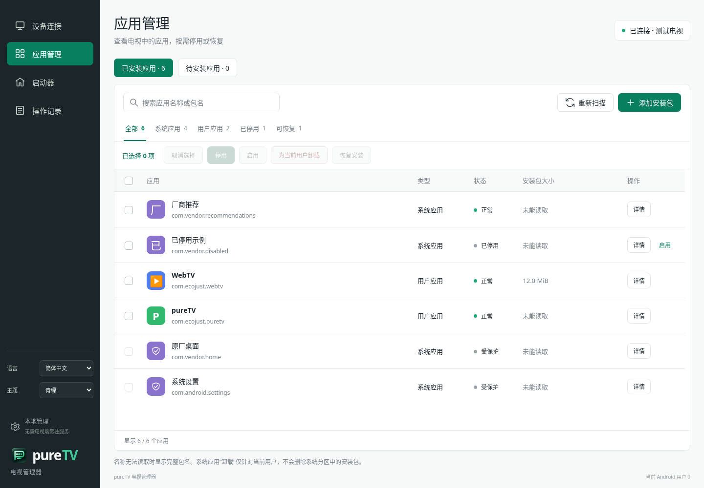
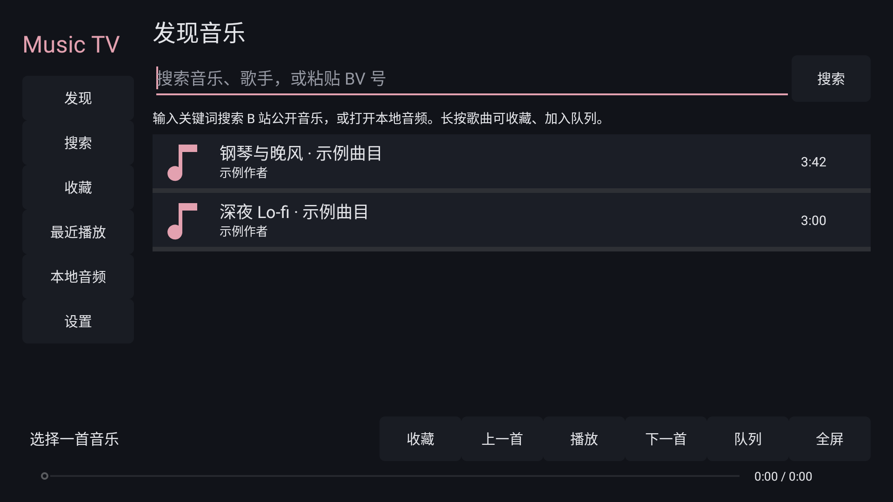
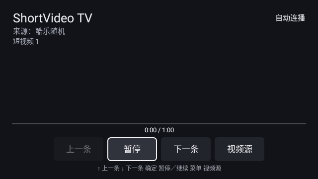
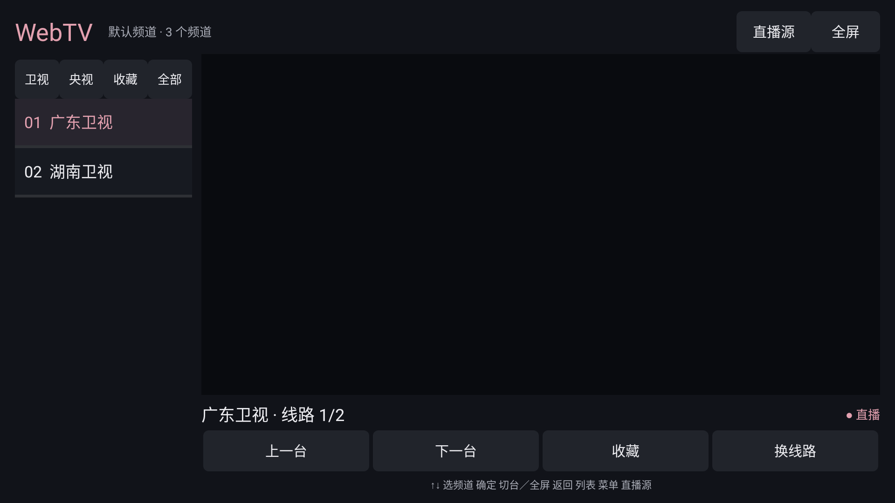
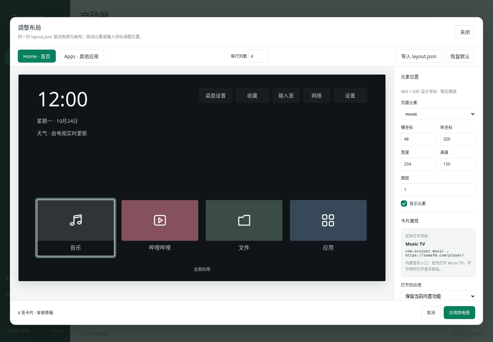
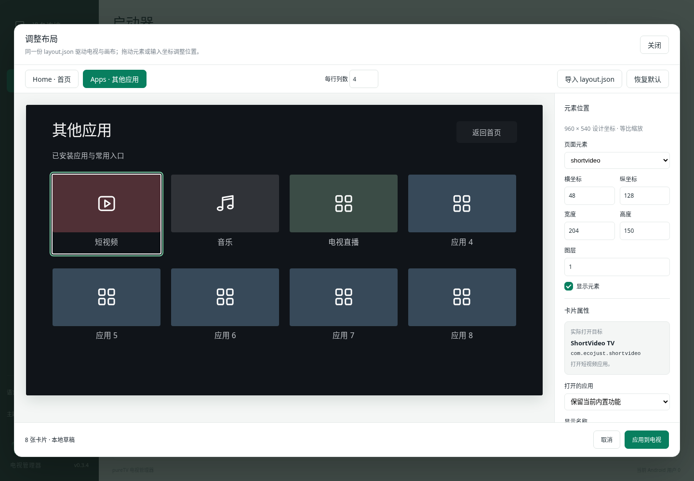

<div align="center">
  
  <h1>pureTV</h1>
  <p>管理你的电视系统、应用与桌面。</p>
</div>

pureTV 是电脑端的 Android TV / Google TV 系统管理器。通过 ADB 连接电视，查看系统信息，安装、卸载、启停应用，选择启动器，并用可视化画布自定义支持的桌面。也可通过 MCP 让 Agent 控制已打开的管理器。



## 下载

[下载 pureTV Manager 0.3.4](https://github.com/ecojust/pureTV/releases/tag/desktop-v0.3.4)

| 系统 | 安装包 |
| --- | --- |
| Windows x64 | 安装版 EXE / 便携 EXE |
| macOS Apple Silicon | ARM64 DMG，macOS 11+ |
| macOS Apple Intel | x86_64 DMG，macOS 11+ |
| Linux x64 | DEB |

首页显示当前电脑的局域网 IPv4、网卡与子网前缀，支持刷新与多网卡。电视 IP／主机名和端口会在点击连接后自动记住，失败时也保留，下次打开自动填入。连接失败排查见[连接指南](desktop/README.md#连接失败排查)。

管理器安装在**电脑**上。电视开启 ADB／网络调试并接受授权后，即可使用应用管理，不需要安装电视端常驻服务。自定义桌面需另行安装[配套 pureTV Launcher 0.3.4](resource/launcher/)。电视端 APK 直接在资源目录下载，包大小与 SHA256 见各目录；管理器校验值见发布附件；macOS 首次打开说明见[安装指南](desktop/README.md#macos-安装与首次打开)。

## 连接与应用管理

1. 电脑和电视接入可互通的网络，在电视开发者选项中开启 ADB／网络调试。
2. 首页输入电视 IP／主机名与调试端口，在电视上允许电脑连接。常见端口为 5555，以电视实际设置为准。
3. 缺少 ADB 时，阅读并同意 Android SDK 许可后点击「下载并配置 ADB」；优先 Google，失败时使用腾讯镜像。也可选择已有 ADB。

连接后首页显示型号、Android／SDK／安全补丁、CPU、内存、`/data` 磁盘容量、分辨率及运行时间。其他页面顶部保留当前连接状态。

- **应用管理**：搜索和分类，批量启用／停用、为当前用户卸载、恢复仍保有安装包的系统应用。
- **待安装应用**：导入本地 APK，可在行尾安装单个，也可勾选批量安装；成功项移出队列，失败与未执行项保留。
- **启动器**：导入启动器 APK 后在该页面直接安装，选择／恢复默认桌面；支持接口的当前启动器显示「调整布局」。
- 应用与启动器均显示主 APK 与分包的合计大小，不含私有数据、缓存与优化文件，无法读取时明确显示未知。
- 列表内部滚动，表头和顶部批量操作固定；核心系统组件与当前默认启动器受保护。

系统应用卸载只针对当前 Android 用户，保留数据，不删除系统分区 APK。新安装且具备启动入口的用户应用可加入启动器排布。

## 语言、主题与 Logo

左下角可切换 **简体中文 / 繁體中文 / English**，以及 **青绿 / 深蓝 / 石墨** 三种主题。偏好保存后重启仍生效；应用名称、包名及文件路径保持原样。新 Logo 将 P、电视屏幕与应用卡片融为一个图形。

| English · 深蓝 | 繁體中文 · 石墨 |
| --- | --- |
|  |  |

## 启动器与电视应用资源

公共目录为 [resource/](resource/)，分为 [launcher/](resource/launcher/) 与 [apps/](resource/apps/)，原根目录的启动器和应用源码已整体移入。以后 Release 只发布电脑管理器；启动器和电视应用 APK 直接放在各自软件目录。每个软件文件夹至少包含一个实际 APK，可同时提供对应版本源码、封面、作者、许可证及 SHA256。点击软件名称进入对应文件夹。

启动器表格的“支持自定义”指支持本管理器的 **layout.json 版本 3 场景画布接口**。卡片背景仅在提供 `thumb.png`／`APK名.thumb.png` 等图片，或手动选择图片后显示。

```text
resource/
├── launcher/          # 启动器源码、pureTV-0.3.4.apk、layout 示例和封面
└── apps/
    ├── music/         # Music TV 源码与 APK
    ├── shortvideo/    # ShortVideo TV 源码与 APK
    ├── webtv/         # WebTV 源码与 APK
    ├── tvbro/         # TV Bro APK 与对应源码
    └── jellyfin-tv/   # Jellyfin TV APK 与对应源码
```

<!-- resource-index:start -->

### 启动器

| 名称 | 作者 | 版本 | 支持自定义 | 封面截图 |
| --- | --- | --- | --- | --- |
| [pureTV Launcher](resource/launcher/) | ecojust / 桔子桑 | 0.3.4 | 是 |  |

### 电视应用

| 名称 | 作者 | 版本 | 用途 | 封面截图 |
| --- | --- | --- | --- | --- |
| [Jellyfin for Android TV](resource/apps/jellyfin-tv/) | Jellyfin contributors | 0.19.10 | Jellyfin 媒体服务器的 Android TV 客户端 |  |
| [Music TV](resource/apps/music/) | ecojust / 桔子桑 | 0.1.1 | 原生电视音乐播放器 |  |
| [ShortVideo TV](resource/apps/shortvideo/) | ecojust / 桔子桑 | 0.1.0 | 遥控器短视频播放器 |  |
| [TV Bro](resource/apps/tvbro/) | Fedir Tsapana (truefedex) | 2.1.6 | 适配遥控器的电视浏览器，使用系统 WebView |  |
| [WebTV](resource/apps/webtv/) | ecojust / 桔子桑 | 0.1.0 | 电视直播与 M3U 播放器 |  |

<!-- resource-index:end -->

所有电视应用的 APK 与源码见 [resource/apps/](resource/apps/)。第三方资源保留各自作者、原始签名和许可证，不纳入 pureTV 的 MIT 授权范围。

## layout.json 规范与画面对照

**pureTV Launcher 0.3.4 使用版本 3 场景协议。** 同一份 JSON 由电视 Home/Apps 页面与管理器画布读取，不再在管理器里猜测固定区域。管理器仍可编辑旧版启动器的版本 2 网格；要移动顶部按钮等元素，请安装资源目录中的新版 APK。

完整可用文件：[layout.example.json](resource/launcher/layout.example.json)，与[电视内置模板](resource/launcher/app/src/main/assets/layout.json)、[管理器模板](desktop/public/layout.json)一致。文件包含首页和应用页的全部默认元素。下列片段展示字段关系（省略部分元素，完整配置请下载示例）：

```json
{
  "version": 3,
  "home": {
    "columns": 4,
    "scene": {
      "background": {"frame":{"x":0,"y":0,"width":960,"height":540},"visible":true,"zIndex":0,"color":"#101419"},
      "elements": [
        {"id":"clock","frame":{"x":48,"y":34,"width":260,"height":65},"visible":true,"zIndex":2},
        {"id":"settings","frame":{"x":824,"y":34,"width":88,"height":40},"visible":true,"zIndex":2},
        {"id":"allApps","frame":{"x":48,"y":492,"width":864,"height":24},"visible":true,"zIndex":2}
      ]
    },
    "items": [
      {"packageName":"com.phlox.tvwebbrowser","icon":"app","label":"浏览器","color":"#374959","frame":{"x":48,"y":326,"width":204,"height":150},"visible":true,"zIndex":1}
    ]
  },
  "apps": {
    "columns":4,
    "scene": {
      "background":{"frame":{"x":0,"y":0,"width":960,"height":540},"color":"#101419"},
      "elements":[{"id":"backHome","frame":{"x":800,"y":30,"width":112,"height":40},"visible":true,"zIndex":2}]
    },
    "items":[]
  }
}
```

| 字段 | 规范及画面含义 |
| --- | --- |
| `version` | 新协议固定为 `3`；必需 `home` 与 `apps` 两个页面 |
| `frame` | 所有背景、固定控件和应用卡片共用 `{x,y,width,height}`，使用 **960×540** 设计坐标；整数，尺寸为正，边界不能超出画布。不同电视分辨率等比缩放，非 16:9 留边 |
| `visible` / `zIndex` | 是否显示（默认 true）／层级（0–20，默认 1）。隐藏的元素在编辑器中以虚线淡显，电视上隐藏；数值越大越靠前。同层背景在前、控件按数组顺序、卡片按数组顺序绘制，后绘制覆盖先绘制 |
| `scene.background` | 同样有 frame、visible、zIndex；`color` 必须为 #RRGGBB。可选 `image` 为嵌入式 PNG/JPEG/WebP data URI，最大 33,000 字符、解码尺寸最大 1920×1080；按背景区域居中裁切。管理器导入图片会自动缩放压缩，不保存电脑路径或远程 URL |
| `scene.elements` | 固定功能元素列表。首页 id：`clock`、`date`、`weather`、`wallpaper`（桌面设置）、`favourites`、`inputs`、`network`、`settings`、`allApps`；应用页 id：`title`、`subtitle`、`backHome`。id 不得重复；省略元素即不显示 |
| 固定控件行为 | 时钟、天气、网络保持电视实时状态，顶部按钮继续使用启动器既有功能；JSON 只定义位置、尺寸、层级和可见性。天气还需在电视中开启并配置城市。遥控器方向键根据元素实际位置寻找目标 |
| `items` | 首页最多 24 项，应用页最多 100 项，可为空；同页包名不重复。新应用必须为当前用户已安装、启用且可启动的非系统应用；不能通过布局添加系统应用 |
| `packageName` / `action` | 用户应用使用包名。默认内置卡片可用 music/bilibili/files/apps/shortvideo/webtv/placeholder；与包名互斥，不支持任意 Intent 或命令。`apps` 内置卡片是应用商店；打开应用页用固定控件 `allApps` |
| `label` / `icon` / `color` | 可选名称 ≤100 字；icon 为 app/music/video/files/apps/picture/settings/input，app 使用应用原图标；卡片色为 #RRGGBB。修改显示名称不会改变真实打开目标 |
| `columns` | 1–6；用于自动排布和未指定 frame 的卡片。编辑器更改列数会重新排布卡片，之后可独立移动。已有显式 frame 的卡片以 frame 为准 |

文件为 UTF-8，整体最多 **48 KiB**；未知字段、越界坐标、重复控件或无效图片会被拒绝，不覆盖上次有效配置。模板里的每张卡片都有明确 frame；导入时未指定 frame 的卡片使用统一自动排布规则，编辑器拖动后写入明确坐标。固定按钮的功能不通过 JSON 改写。

| 示例文件与画面对应 | 管理器画布 |
| --- | --- |
| 完整 layout.example.json 的 home：左上时钟／日期／天气位置，右上五个按钮，下方四张卡片与全部应用入口 |  |
| 同一文件的 apps：标题、副标题、返回按钮，以及两行应用卡片 |  |

画布使用 JSON 中的真实位置和尺寸；时钟、日期、天气为示例内容，电视端显示实时数据。图片是管理器示例数据画布，不是实机录屏；资源目录封面则由 Android 页面原生渲染测试生成。电视每次页面恢复／配置应用时重新加载，无需重启。私有 `files/layout.json` 优先于外部 `Android/data/com.ecojust.puretv/files/layout.json`；**不读取、不迁移旧版 apps.json**。版本 2 自定义布局在新版电视启动器上需重新导入为版本 3，原文件不自动覆盖。

更多编辑、恢复及 MCP 说明见[布局文档](desktop/docs/launcher-layout.md)。

## MCP / Agent

在「设备连接 → MCP · Agent 调试」复制配置到客户端，保持管理器窗口打开。30 个工具覆盖系统信息、连接、应用管理、APK 安装、启动器切换与布局、背景图、ADB 配置、语言与主题、取消及记录；Agent 与界面共享状态。

[完整 MCP 接入与参数](desktop/docs/mcp.md)。

## 电视端包名与升级

当前包名为 **`com.ecojust.puretv`**，沿用 pureTV 0.2.0 的发布证书，可覆盖升级。更早的 `com.ecojust.cleanyourtv` 是另一个应用，需要独立安装并重新选择默认桌面，不能继承其私有设置。建议先保留原桌面，确认新版运行正常后再处理旧应用。

## 开发与验证

电脑端：[构建与运行](desktop/README.md)。电视端使用 JDK 17／21、Android SDK Platform 35、Build Tools 34.0.0：

```bash
cd launcher
./gradlew assembleDebug assembleRelease lintDebug testDebugUnitTest
```

资源校验：`python tools/resource_catalog.py --build-tools <Build Tools 34.0.0 路径>`。资源索引：`python tools/update-resource-index.py`。

项目使用核心、界面、四平台构建、原生管理器 MCP 联调与 Android 布局测试验证。尚未进行电视实机测试。

## 许可与致谢

pureTV 使用 [MIT](LICENSE) 许可。部分电视端启动器代码参考 [Gathin23/cleanyourtv](https://github.com/Gathin23/cleanyourtv)，原作者版权与许可保留于 [NOTICE.md](NOTICE.md)。字体见 [OFL 许可](resource/launcher/FONT-LICENSE-OFL.txt)。第三方 APK、截图与源码使用各资源文件夹内的许可证。
