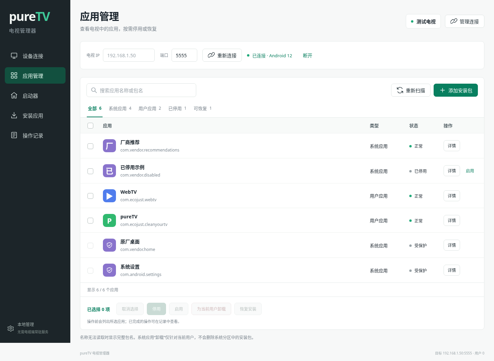
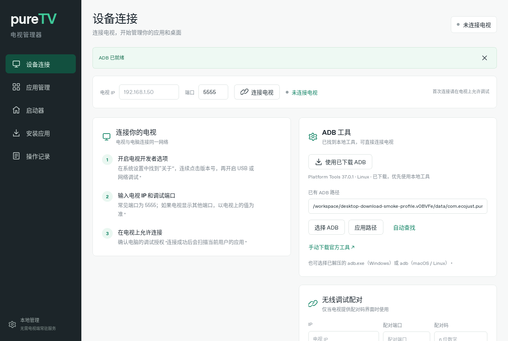
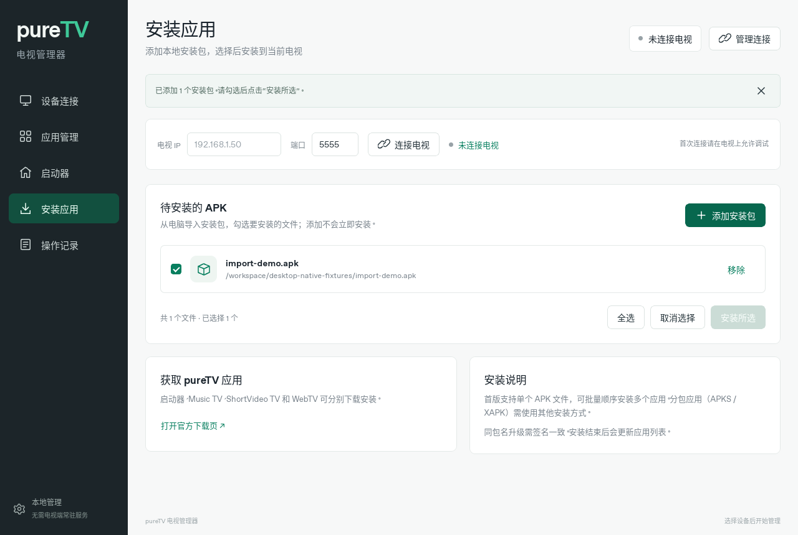

# pureTV 电视管理器

通过 ADB 在电脑上管理 Android TV / Google TV 的独立桌面应用。负责连接电视、查看应用、停用／恢复、为当前用户卸载、安装外部 APK 和选择默认启动器。它与电视上的 pureTV 启动器、Music TV、ShortVideo TV、WebTV 分别安装；电视端无需额外常驻管理服务。

版本 **0.1.3**。Windows x64 优先，提供 macOS Apple Silicon（macOS 11 及以上）和 Linux x64 构建。下载入口：[桌面工具发布页](https://github.com/ecojust/pureTV/releases/tag/desktop-v0.1.3)。缺少 ADB 时，可直接在应用内下载并配置 Google 官方 Platform Tools，Google 不可达时自动尝试腾讯镜像，无需手动解压和寻找文件。



## 安装包大小

| 平台／格式 | 0.1.3 安装包大小 |
| --- | --- |
| Windows x64 安装版 EXE | 1,508,749 字节，约 1.44 MiB |
| Windows x64 便携 EXE | 4,156,416 字节，约 3.96 MiB |
| macOS ARM64 DMG | 1,866,652 字节，约 1.78 MiB |
| Linux x64 DEB | 2,370,708 字节，约 2.26 MiB |

1 MiB = 1,048,576 字节。以上为本版实际发布文件大小，已下载并核对 SHA256，完整校验清单见[发布页](https://github.com/ecojust/pureTV/releases/tag/desktop-v0.1.3)。不包含首次按需下载的 Platform Tools 和系统 WebView；安装后的占用及内存依运行环境而异。

源码中的应用列表新增用户应用“安装包大小”（主 APK 与分包合计，不含私有数据和缓存，读取不到时明确显示）。应用、启动器、待安装 APK 和操作记录均独立滚动，批量操作位于列表顶部；这些改进随下一版管理器发布。

## MCP / Agent 调试（开发中）

源码已加入控制当前窗口的 MCP 接口，覆盖全部电视管理功能；在「设备连接 → MCP · Agent 调试」复制配置。接入方式、20 个工具及验证说明见 [MCP 文档](docs/mcp.md)。此功能尚未包含在已发布的 0.1.3 安装包中。

## 功能

| 页面 | 能做什么 |
| --- | --- |
| 设备连接 | 输入 IP／主机名和端口连接 ADB，区分等待授权、在线、离线；支持有配对功能的电视；自动寻找、在线下载并配置或手动选择 ADB |
| 应用管理 | 扫描当前电视用户所有已安装应用，按包名／已知名称搜索，区分系统、用户、停用、可恢复；勾选后停用、启用、卸载或恢复 |
| 启动器 | 查看已安装 HOME 启动器，导入本地启动器 APK，选择默认桌面并恢复记录的原桌面 |
| 安装应用 | 点击「添加安装包」从电脑导入外部 APK，多次追加去重，勾选后安装；从列表移除不会删除源文件 |
| 操作记录 | 保存最近 200 项修改结果，显示具体电视、用户、目标、成功／失败及原因 |

先使用真实包名完成清单，不为扫描批量下载电视上的 APK。已知 pureTV／常见系统包显示友好名称，其他包以包名展示；首版不保证全部应用的本地化名称和图标。

## macOS 安装与首次打开

当前 DMG 适用于 **Apple Silicon（M1 及后续芯片）、macOS 11 或更高版本**，不支持 Intel Mac。打开 DMG，将 `pureTV Manager.app` 拖入 `Applications`，再从「应用程序」打开。

应用对整个 `.app` 执行 ad-hoc 签名，最低系统版本为 macOS 11。**ad-hoc 签名不是 Developer ID 签名，也不代表通过 Apple 公证**；首次打开仍可能出现来源或开发者验证提示。

- 提示「无法验证开发者」：尝试打开一次后，进入「系统设置 → 隐私与安全性」，找到 pureTV Manager 的拦截信息并选择「仍要打开」（Open Anyway）。macOS 11／12 的入口为「系统偏好设置 → 安全性与隐私」。
- 提示「已损坏，无法打开」：先从本仓库的 [0.1.3 发布页](https://github.com/ecojust/pureTV/releases/tag/desktop-v0.1.3) 下载 DMG 和 `SHA256SUMS.txt`，在终端进入下载目录并计算校验值：

  ```bash
  cd ~/Downloads
  shasum -a 256 pureTV-Manager-0.1.3-macos-arm64.dmg
  ```

  将输出的完整 SHA256 与 `SHA256SUMS.txt` 中同名文件的一行比较；不一致时重新下载，不要打开该副本。校验一致后，重新将 DMG 中的应用拖入「应用程序」，覆盖旧版。

  如果校验一致、确认文件来自本仓库，重新安装后仍因下载隔离属性被拦截，可在终端对这一份可信应用解除隔离，然后再打开：

  ```bash
  xattr -dr com.apple.quarantine "/Applications/pureTV Manager.app"
  ```

  此命令仅移除上述应用的下载隔离属性，不使用 `sudo`，不关闭全局 Gatekeeper。如果仍打不开，请提供完整提示和 macOS 版本；不要扩大命令作用范围。**此方法不适用于「将损坏电脑」或其他恶意软件警报。**

## 连接与使用

1. 在电脑安装并打开本工具。程序会检测已有 ADB；缺少时在「ADB 工具」点击「下载并配置 ADB」，查看下载信息，阅读并勾选 Android SDK 许可后确认。程序优先从 Google 官方下载，失败时自动尝试腾讯镜像，校验、解压并自动配置；完成后可连接电视。已有工具也可通过「选择 ADB」手动指定，离线电脑保留此方式。
2. 电视和电脑位于可互通网络，在电视开发者选项开启 ADB／网络调试。输入电视实际 IP 和端口，点击连接，在电视上接受电脑调试授权。常见端口为 5555，以设备实际配置为准。
3. 若电视提供「无线调试 → 配对码」，先输入配对端口和配对码；配对成功后用电视显示的**调试端口**连接，两者可能不同。配对码不保存。
4. 连接后扫描应用。选择具体目标并确认后执行；批量操作逐项记录，失败不会显示为成功。扫描可取消；批量变更可停止后续项，正在执行的安装／修改会先完成并复查，已完成项不会自动回滚。
5. 安装应用时点击「添加安装包」，选择自己的 `.apk` 文件，勾选后点击「安装所选」。添加文件不会立即安装。每次最多安装 10 个，应用批量操作每次最多 100 项。首版接受普通单 APK，分包 APK／APKS／XAPK 需先使用其他工具处理。
6. 更换桌面时先安装目标启动器，再在启动器页面设置默认桌面。部分厂商不允许修改或重启后恢复原桌面，软件会按实际查询结果反馈。

## 在线准备 ADB

在线下载固定为 Google 官方 **Android SDK Platform Tools 37.0.1**，下载信息和 Android SDK 许可在确认前展示。只有用户勾选许可并确认后才开始；打开软件、浏览器预览或进入连接页面不会自动下载。下载中显示字节数、百分比及校验／解压／检查阶段，可取消，失败后可重试。

| 电脑平台 | 官方 ZIP 下载量 | 解压后工具文件大小 |
| --- | --- | --- |
| Windows x64 | 8,044,989 字节，约 7.67 MiB | 约 16.72 MiB |
| macOS Apple Silicon | 16,110,554 字节，约 15.36 MiB | 约 37.02 MiB |
| Linux x64 | 9,054,187 字节，约 8.63 MiB | 约 21.17 MiB |

程序使用内置的 Google 官方和腾讯镜像 HTTPS 地址，优先尝试 Google，连接、下载或校验失败时自动切换腾讯镜像；每次切换都会清除未完成的下载。所有来源均核对预期字节数和 SHA256 后解压完整工具集，保留 Windows DLL 及许可／NOTICE 文件，再检查 `adb version` 并保存路径。校验不通过不会运行下载文件；取消或失败会清理临时文件，并保留原有 ADB 配置。

工具保存在本应用数据目录 `tools/` 下的独立版本目录，只占用电脑空间，不更改系统 PATH 或 macOS `.app`。下载成功后可点击「使用已下载 ADB」，勾选 SDK 许可并「验证并使用」；缓存完整时无需联网，校验发现损坏时会从 Google 或备用腾讯镜像重新下载到新目录，不覆盖之前在用的工具。更换 ADB 前需先断开电视；工具版本随管理器发布维护。

如果 Google 和腾讯镜像均不可达，可通过 [官方 Platform Tools 页面](https://developer.android.com/tools/releases/platform-tools) 在其他电脑下载，完整解压后使用「选择 ADB」指定 `adb.exe`（Windows）或 `adb`（macOS/Linux）。Windows 的 `AdbWinApi.dll`、`AdbWinUsbApi.dll` 应与 `adb.exe` 保持在同一目录。

自动查找仍支持已保存的路径、`PURETV_ADB`、程序旁的 `platform-tools/`、PATH、`ANDROID_HOME`／`ANDROID_SDK_ROOT` 和常见 SDK 路径。管理器安装包不捆绑 Platform Tools，按需下载的 ZIP 和解压后工具占用另计。



## 操作范围和恢复

应用扫描与变更绑定所连接设备及当前 Android 用户。每次修改前检查设备与用户，未授权或用户切换时停止执行；关键系统包和当前默认启动器受保护。

厂商限制 HOME 查询时仍显示应用清单，但暂时阻止停用／卸载；恢复 HOME 查询后再操作。

系统软件的「为当前用户卸载」使用 `pm uninstall -k --user`，保留数据且不删除系统分区 APK，因此不能承诺释放其系统分区空间。恢复使用 `install-existing`，只对设备仍保有安装包的应用有效；普通第三方 App 可能需要重新安装 APK。停用和当前用户卸载是两种不同操作。

选择启动器时会记录当前用户原桌面；恢复前仍需确认对应组件存在且可用。管理器不会自动停用原厂桌面，不会批量预选所谓推荐清理项目。

配置和操作记录位于系统应用数据目录 `com.ecojust.puretv.manager` 下，保存 ADB 路径、有限的原桌面记录及操作日志。配对码和 APK 内容不保存；删除待安装列表项不删除电脑文件。

## 精简实现

Tauri 2、Rust、原生 TypeScript/CSS，使用系统 WebView，无前端框架、数据库、遥测或网络后端。Windows 发行包未使用商业代码签名证书；macOS 使用 ad-hoc 应用包签名，未使用 Developer ID 证书、未完成 Apple 公证。Windows 使用系统 WebView2；安装程序可在需要时安装 WebView2，便携 EXE 需要电脑已具备该运行时。Linux 依赖 WebKitGTK，macOS 使用系统 WebView。

后台核心只开放明确的 ADB 操作，不向网页开放任意 shell。参数经过校验，进程有超时、输出上限和取消机制；修改操作串行，批量逐项复查。前端不引入框架，不下载网页字体或第三方界面资源。实际电脑端安装包大小与内存以各平台构建和测试为准，不能与电视 APK 的体积直接比较。

## 开发与验证

前置：Node.js 22+、Rust stable，以及 [Tauri 各平台开发依赖](https://v2.tauri.app/start/prerequisites/)。

```bash
cd desktop
npm ci
npm run build
cargo test --manifest-path core/Cargo.toml --locked
cargo test --manifest-path src-tauri/Cargo.toml --locked
npm run tauri dev
```

打包：`npm run tauri build`。原生产物在 `src-tauri/target/release/bundle/`；桌面程序与电视 APK 使用不同构建，不需要 Android SDK 构建本工具（连接电视仅需 Platform Tools）。

浏览器控件预览：`npm run dev`，普通模式明确提示需桌面程序；`http://localhost:1420/?demo=1` 是显式演示模式，显示示例数据，下载准备也只作模拟，不下载工具或连接真实设备。

前端交互测试：先执行 `npm run build`，再执行 `npm run test:ui`（需 Playwright Chromium，可先运行 `npx playwright install chromium`）。可通过 `CHROMIUM_PATH` 指定已有 Chromium，通过 `PURETV_CAPTURE_DIR` 保存控件截图。自动化测试使用模拟设备，不能替代电视实机连接和厂商兼容性测试。

官方工具集成验证：`cargo test --manifest-path src-tauri/Cargo.toml --locked official_download_and_offline_reuse -- --ignored --nocapture`。此项会下载当前平台的官方包，运行 `adb version`，检查配置持久化和离线复用，不连接电视。

0.1.2 三平台构建、核心测试、各 8 项工具安装测试，以及真实官方工具下载／`adb version`／配置持久化／离线复用检查均已通过。Linux 的 15 项界面交互测试、macOS 的 DMG 挂载／完整签名／安装副本启动检查也已通过，结果见 [0.1.2 构建记录](https://github.com/ecojust/pureTV/actions/runs/39984220050)。macOS 检查不代表 Apple 公证或 Gatekeeper 批准。`desktop-v*` 标签发布桌面工具，Android 最新版本入口保持独立。

0.1.2 发布前的本地验证已通过 30 项 Rust 核心测试、8 项工具安装测试、15 项浏览器交互场景及真实 Linux 官方工具下载／配置／离线复用检查。交互场景覆盖 SDK 许可确认、下载取消与重试、外部 APK 添加去重、勾选安装、保护组件、启动器恢复、失败结果和窄窗口布局。Linux 原生窗口已完成首次启动、许可确认、真实下载进度、自动配置和连接按钮启用的完整流程验证；此前已验证系统文件选择器和外部 APK 导入。未连接真实电视。



[已确认的设计提案](docs/design-proposal.png) · [ADB 命令调研](docs/adb-research.md)

本项目参考自 [Gathin23/cleanyourtv](https://github.com/Gathin23/cleanyourtv)。本目录为电脑端管理工具实现，原作者版权和许可见仓库 [LICENSE](../LICENSE) 与 [NOTICE.md](../NOTICE.md)。

0.1.3 三平台构建、核心与工具安装测试、真实官方工具下载及离线复用、腾讯镜像下载及 ADB 运行检查均已通过；Linux 的 15 项界面测试、macOS DMG／完整签名／安装副本启动检查也已通过，见 [0.1.3 构建记录](https://github.com/ecojust/pureTV/actions/runs/39989740541)。四个发布附件均已下载并核对 SHA256。
