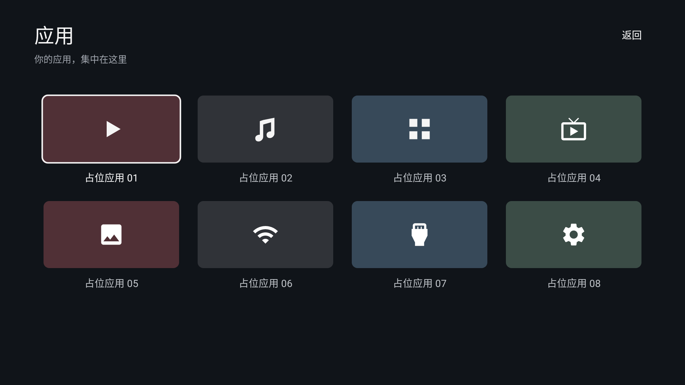

# 验证记录

## 环境与范围

- Linux x86_64，完整 OpenJDK 21，Gradle 8.9。
- Android SDK Platform 35、Build Tools 34.0.0。
- Robolectric 模拟 Android 9（API 28），原生图形渲染验证 1920×1080 与 640×360 布局。
- 未连接电视；Robolectric 不等同于电视实机或完整系统模拟器。

## 检查结果

- Debug 与 Release 构建成功（公开发布 APK 另外使用项目发布密钥签名）；应用标识 `com.ecojust.cleanyourtv`，版本 `0.1.0`。
- 15 项测试通过：4 项壁纸下载测试、8 项页面导航测试、3 项原生图形布局测试。
- 布局验证：四个桌面卡片位于屏幕下半部，首次进入显示焦点；小屏卡片不越界；应用页可展示 8 个占位项。
- 导航验证：点击「应用」进入独立页面，点击占位项显示提示，返回按钮关闭页面，方向键可到达顶栏及返回入口；音乐卡片以可浏览的 HTTPS Intent 打开 SomaFM；影视卡片打开 Plex 免费点播区；浏览器不可用时分别显示对应提示。
- 影视站点：`https://watch.plex.tv/on-demand` 返回 HTTP 200，已通过桌面浏览器检查实际页面和分类内容。内容以海外影视为主，免费服务含广告，片源及播放受地区限制；未在电视上实测播放。
- 音乐站点：`https://somafm.com/player/` 与官方频道列表均返回成功响应，检查时包含 51 个免费电台频道。网页可访问检查不能替代电视端浏览器的音频播放实测。
- lint 为 0 errors / 81 warnings，仍有参考资源的旧版本属性、未使用资源及布局建议。
- Android XML 可解析；Bash 安装和壁纸脚本通过语法检查。
- 壁纸脚本以模拟 adb 验证默认/自定义端口、含空格路径、PNG 输入、缺失参数与文件时提前退出；所有设备操作均指定目标设备。
- Picsum 地址实际下载返回 HTTP 200、JPEG、1920×1080；壁纸测试覆盖字节保真、恰好 4 MiB、无 Content-Length 的超限流及网络中断。

```bash
cd launcher
./gradlew --no-daemon assembleDebug assembleRelease lintDebug testDebugUnitTest
```

## 界面渲染预览

以下图片来自真实 Android XML 与 Java 界面的 Robolectric 原生渲染，并非电视实机截图。桌面预览使用指定 Picsum 地址的样例图片；天气默认关闭，所以不显示天气行。




测试默认不生成文件。需要导出预览时，可设置 `CLEAN_UI_CAPTURE_DIR` 指定目录，`CLEAN_UI_TEST_WALLPAPER` 可指定一张本地测试图片；这两个变量只用于测试，不影响 APK。

## 电视上仍需验证

1. 安装后可从系统应用列表打开，设为默认桌面后按 Home 返回。
2. 真机遥控器遍历四个入口、顶栏和弹窗；列表页按返回或 Home 正常回桌面。
3. 安装哔哩哔哩 TV 版后能从对应卡片启动；未安装时提示明确。
4. 开启每日随机壁纸后成功显示；同日重复开启使用缓存；关闭后保留当前图；断网时保留旧图。
5. 本地图片导入/移除、减弱动画、天气城市搜索、网络设置和输入源按设备能力工作。
6. 可选无障碍快捷键及系统时钟屏保正常。

应用页当前为占位预览，尚未接入真实已安装应用列表。厂商默认桌面限制、遥控器键值及系统设置入口仍需要对应设备验证。
