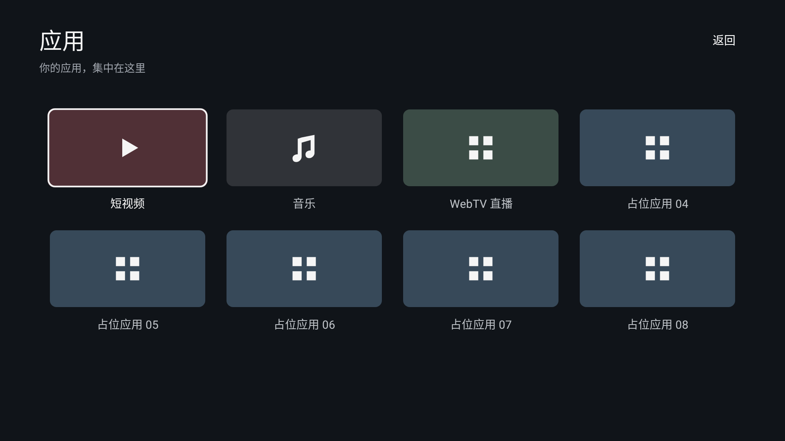

# pureTV Launcher 0.3.0

作者：ecojust / 桔子桑。包名 com.ecojust.puretv，沿用 0.2.0 发布证书，可直接升级。

[下载 APK](pureTV-0.3.0.apk?raw=1) · [对应源码](source.tar.gz) · [layout.json 示例](layout.example.json) · [规范与画面对照](../../README.md#layoutjson-规范与画面对照) · [SHA256](SHA256SUMS.txt)

支持 pureTV 管理器的 layout.json 版本 2 接口，home/apps 页面分别设置列数、顺序、名称、图标和颜色。只允许添加已安装可启动的用户应用，不兼容旧版 apps.json。

图片由对应版本的实际 Android 页面在 Robolectric 原生图形环境中渲染，非实机录屏。源代码树、构建记录、APK 哈希与发布证书见 [resource.json](resource.json)。许可证及上游致谢见 [LICENSE](LICENSE) 与 [NOTICE.md](NOTICE.md)。
